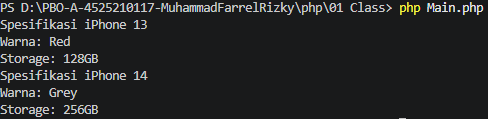
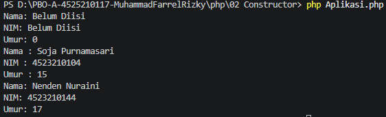
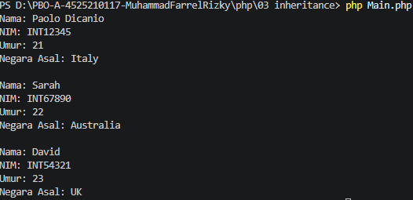
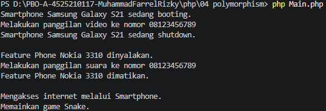
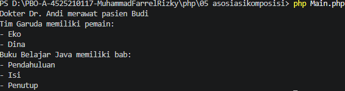
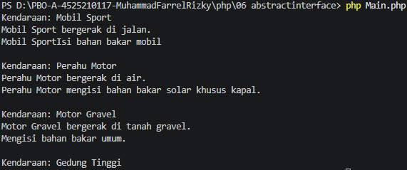

# Tugas 1 Pemrograman Berbasis Objek (PBO)

**NAMA : MUHAMMAD FARREL RIZKY**  
**NPM  : 4525210117**  

---

## Konversi Source Code Java ke PHP (Pertemuan 01 - 06)

Repositori ini berisi hasil konversi kode program berorientasi objek dari bahasa pemrograman Java ke PHP untuk pertemuan 01 sampai dengan 06, lengkap dengan hasil output eksekusi setiap program.

---

## Pertemuan 01: Class & Object
Materi ini membahas pembuatan kelas dasar dan instansiasi objek di PHP.

### Screenshot Hasil Output

---

## Pertemuan 02: Constructor & Destructor
Materi ini membahas penggunaan metode `__construct()` untuk inisialisasi properti objek saat objek diciptakan.

### Screenshot Hasil Output

---

## Pertemuan 03: Inheritance (Pewarisan)
Materi ini membahas mekanisme pewarisan sifat dan properti dari *parent class* ke *child class* menggunakan kata kunci `extends`.

### Screenshot Hasil Output

---

## Pertemuan 04: Polymorphism (Polimorfisme)
Materi ini membahas kemampuan suatu objek untuk memiliki banyak bentuk melalui teknik *method overriding*.

### Screenshot Hasil Output

---

## Pertemuan 05: Asosiasi & Komposisi
Materi ini membahas hubungan antar objek, baik hubungan asosiasi maupun hubungan komposisi/agregasi.

### Screenshot Hasil Output

---

## Pertemuan 06: Abstract Class & Interface
Materi ini membahas implementasi abstraksi menggunakan `abstract class` dan kata kunci `implements` untuk `interface`.

### Screenshot Hasil Output

